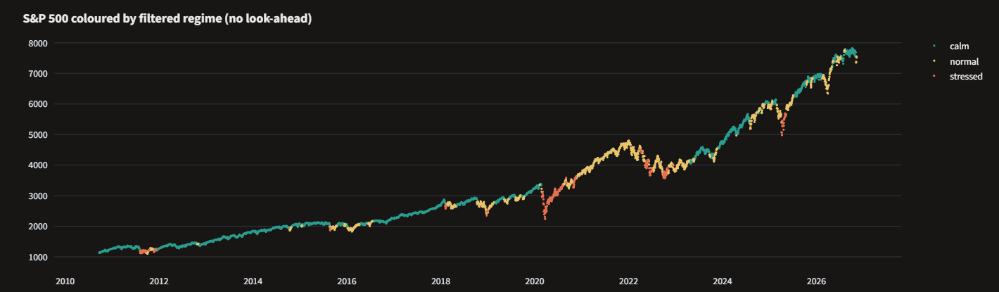
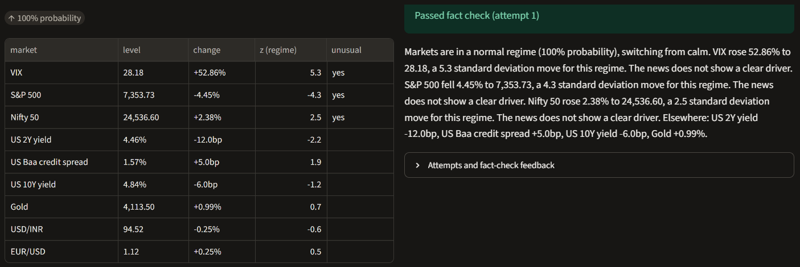

# MarketPulse: Regime-Aware Market Monitor with Fact-Checked Briefs

[](https://github.com/Mahendr99ar/marketpulse/actions/workflows/ci.yml)

[](https://marketpulse-mahendra.streamlit.app)

Author: [Mahendra Meena](https://github.com/Mahendr99ar)

Live app: https://marketpulse-mahendra.streamlit.app

Every morning an analyst on a trading desk writes a short note on what moved overnight and why.
Two parts of that job are hard to automate. First, deciding which moves matter: a 1 % fall in
the S&P 500 is news in a quiet market and noise in a crisis. Second, trusting generated text:
an LLM can write the note in seconds, but if it swaps or invents one number the note is useless.

I built MarketPulse to handle both. It finds the current market regime with a Hidden Markov
Model, scores each daily move against the volatility of that regime, and writes a short brief.
Python computes and rounds every number; the writer only puts them into sentences; a
fact-checker checks the text against the data before anyone reads it.

```
   FRED + Yahoo Finance (9 markets, 2007 to today)          GDELT headlines, central bank statements
              │                                                            │
              ▼                                                            ▼
   ┌────────────────────┐   ┌─────────────────────────┐        ┌──────────────────────┐
   │ features (no look- │──►│ Gaussian HMM, 3 regimes │        │ retrieval            │
   │ ahead): vol, VIX,  │   │ walk-forward, refit     │        │ TF-IDF or embeddings │
   │ returns, credit    │   │ yearly, forward filter  │        └──────────┬───────────┘
   └────────────────────┘   └────────────┬────────────┘                   │ likely driver
                                         │ regime                         │
   daily changes ───────────────────────►▼                                ▼
                            ┌─────────────────────────┐        ┌──────────────────────┐
                            │ z-score vs past vol in  │───────►│ fact sheet: Python   │
                            │ the same regime         │ moves  │ computes every number│
                            └─────────────────────────┘        └──────────┬───────────┘
                                                                          ▼
                                          ┌────────── retry with feedback ─┐
                                          ▼                                │
                                   ┌─────────────┐   fail   ┌──────────────┴──┐
                                   │ writer      │─────────►│ fact-checker    │──► pass: publish
                                   │ (template / │          │ numbers, up/down│
                                   │  LLM)       │          │ regime name     │──► still failing:
                                   └─────────────┘          └─────────────────┘    needs human review
```



The chart is the S&P 500 from late 2010 to November 2026, coloured by the regime the model
assigned on each day using only data up to that day. The stressed regime (red) shows up in
mid 2011, from the March 2020 crash through most of 2020, in parts of 2022, and in April 2025.
The Q4 2018 selloff only reached the normal regime (yellow). The model also stays in the
stressed regime for months into the 2020 recovery, which is the lag you pay for a filter that
cannot see the future.

## Features

| Area | What I implemented |
|------|--------------------|
| Data | 9 markets from FRED and Yahoo Finance on one business-day calendar; check that warns when one series cuts the history of all others |
| Regimes | Gaussian HMM on 4 features (5-day S&P return, 20-day realised vol, log VIX, 20-day change in Baa credit spread), refit yearly on an expanding window |
| No look-ahead | Own forward-algorithm filter instead of hmmlearn's `predict` / `predict_proba`, which use the whole sequence; every volatility estimate shifted by one day |
| Stable labels | HMM states sorted by mean volatility after every refit, so state 0 is always the calmest |
| Detector | z-score of each move against past volatility in the same regime; rolling-volatility and fixed-threshold baselines; precision, recall, McNemar's test |
| News | GDELT DOC API in one OR query per 3-day chunk, with pauses, retries, resumable cache, newest days first |
| Retrieval | TF-IDF baseline and sentence-transformer embeddings; recall@k and MRR on labelled days; low-scoring headlines dropped so the brief does not invent a cause |
| Briefs | Pydantic fact sheet, LangGraph write → check → retry loop, writers: template, Ollama, Groq, fine-tuned model |
| Fact-checker | Every number must belong to a market named in the same sentence; up/down words checked against the sign; regime name checked |
| Fine-tuning | Distillation dataset filtered by the fact-checker, Unsloth LoRA script, train/test split by date |
| CI | GitHub Actions runs 16 tests and the full demo pipeline on every push |

## Results

All results below are on real data: 4,985 business days from 2007-09-17 to 2026-11-10.
Out-of-sample regime predictions start in late 2010, after 3 years of training data, so the
2008 crisis is in the training window only.

### Regimes

| Regime | Share of out-of-sample days | S&P 500 realised vol | VIX (approx.) | Baa spread, 20-day change | Expected duration |
|--------|-----------------------------|----------------------|---------------|---------------------------|-------------------|
| calm | 63 % | 9.4 % | 14 | −3.7 bp | 62 days |
| normal | 30 % | 16.5 % | 20 | +2.1 bp | 38 days |
| stressed | 7 % | 34.9 % | 33 | +4.7 bp | 57 days |

Nobody told the model that volatility and credit spreads rise together in stress. It found
that from the data.

**How many regimes?** BIC on the first 60 % of the data kept falling from 2 to 5 states
(20,294 → 16,813 → 14,875 → 14,370). That does not mean 5 states are right. Daily returns
have much fatter tails than a normal distribution, so a Gaussian HMM keeps adding states to
explain the extreme days. I chose 3 because the profiles are clearly different and easy to
interpret.

### Unusual moves

| Detector | Cells flagged (4,209 days × 9 markets) |
|----------|----------------------------------------|
| Regime-conditional z-score, \|z\| ≥ 2.5 | 1,054 (2.8 %) |
| Rolling 252-day z-score, \|z\| ≥ 2.5 | 1,065 |
| Fixed size (1.5 % or 10 bp) | 5,254 |

Under a normal distribution about 1.2 % of cells would pass \|z\| ≥ 2.5, so 2.8 % is another
sign of fat tails. The two z-score detectors flag almost the same number of cells; whether they
flag the *same* moves, and which one a desk analyst would agree with, is what the hand labels
will answer.



On 5 November 2026 the detector flagged three moves: VIX +52.86 % (z 5.3), S&P 500 −4.45 %
(z −4.3) and Nifty 50 +2.38 % (z 2.5), and the regime switched from calm to normal. The brief
above passed the fact check on the first attempt. It comes from the template writer; the news
download for that week was not finished yet, so it says no clear driver was found instead of
guessing one.

### Does the fact-checker catch errors?

I took briefs that passed and planted errors in them: a changed number, a flipped direction
word (rose ↔ fell), or a wrong regime name.

| Error type | Planted | Caught | Catch rate |
|------------|---------|--------|------------|
| Changed number | 90 | 89 | 98.9 % |
| Flipped direction | 90 | 90 | 100 % |
| Wrong regime | 90 | 90 | 100 % |

My first version only checked that each number existed somewhere in the facts, and it caught
80 of 90 planted number errors: a changed value sometimes matched another market's number.
I changed it so a number must belong to a market named in the same sentence. A swap between
markets listed in the same sentence ("Elsewhere: ...") can still get through.

### Sanity check on synthetic data

Before trusting the models on real data I ran them on synthetic data with known regimes and
60 planted shocks.

| Check | Result |
|-------|--------|
| Out-of-sample regime accuracy (majority class 50.3 %) | 75.0 % |
| Detector F1: regime / rolling / fixed | 0.202 / 0.134 / 0.027 |
| McNemar, regime vs rolling detector | regime right and rolling wrong on 351 cells, opposite on 109, p < 0.001 |
| Same model with the 10s2s curve slope added | accuracy drops to 45.0 % |

The curve slope moves slowly, so with it the HMM split the sample by time period instead of
by stress. I removed it from the default features.

## How to run

**Live app**
Open https://marketpulse-mahendra.streamlit.app, choose `real` in the sidebar, pick a date,
and press **Generate brief**.

**Local demo** (synthetic data, no API keys)
```bash
python -m venv .venv
.venv\Scripts\activate              # Linux / macOS: source .venv/bin/activate
pip install -r app/requirements.txt pytest tabulate yfinance fredapi gdeltdoc feedparser python-dotenv
pip install -e .
python -m marketpulse.cli all --demo
pytest
streamlit run app/streamlit_app.py
```

**Real data** (free FRED key in `.env`, see `.env.example`)
```bash
python -m marketpulse.cli data --no-news     # prices, about 2 minutes
python -m marketpulse.cli regimes --select   # walk-forward HMM, BIC for 2 to 5 states
python -m marketpulse.cli detect             # z-scores and flags
python -m marketpulse.cli news               # GDELT headlines, resumable
python -m marketpulse.cli brief --backend template
```

**Labelling and evaluation**
```bash
python -m marketpulse.cli label-sheet        # flagged rows + random rows, shuffled
# fill `notable` with 1/0, save as data/labels/notable_moves.csv
python -m marketpulse.cli evaluate --backend template
```

## Project structure

```
marketpulse/
├── configs/config.yaml               markets, features, thresholds, models
├── src/marketpulse/
│   ├── data/market.py                FRED + Yahoo download, calendar alignment, coverage check
│   ├── data/news.py                  GDELT (rate-limit aware, cached), RSS, statements
│   ├── data/synthetic.py             regime-switching demo data with planted shocks
│   ├── features.py                   regime features
│   ├── regimes.py                    HMM, forward filter, walk-forward, BIC
│   ├── detector.py                   z-scores, baselines, evaluation, labelling sheet
│   ├── retrieval.py                  TF-IDF / embedding retrieval, recall@k
│   ├── generation/facts.py           Pydantic fact sheet
│   ├── generation/factcheck.py       number, direction and regime checks
│   ├── generation/checker_eval.py    planted-error test of the checker
│   ├── generation/writers.py         template, Ollama, Groq, Hugging Face writers
│   ├── generation/brief.py           LangGraph write → check → retry loop
│   └── pipeline.py, cli.py           steps and command line
├── app/streamlit_app.py              the live app
├── finetune/                         distillation dataset builder, Unsloth LoRA training
├── tests/                            leakage, fact-checker and model tests
├── docs/                             roadmap, experiment log, rating rubric, images
└── .github/workflows/ci.yml          tests + demo pipeline on every push
```

## Design notes

- **Filtered, not smoothed, regimes.** hmmlearn's `predict_proba` runs forward-backward over
  the whole sequence, so the probability for March 2020 would use April 2020 data. I wrote the
  forward pass myself. `tests/test_no_lookahead.py` changes future data and checks that past
  outputs stay identical, and one test shows that the smoothed probabilities do change.
- **Python computes, the writer only writes.** The writer gets strings such as `-4.45%` and
  `+5.0bp` and is told not to calculate. That turns number errors into copying errors, which a
  checker can catch.
- **A brief that keeps failing is not thrown away.** After the retries it is marked
  `needs_review`, so a person decides.
- **Unrelated news is worse than no news.** Headlines below a retrieval score threshold are
  dropped, otherwise the brief would attach a cause from whatever ranked first.
- **Baa spread instead of the high-yield spread.** Since April 2026 FRED serves only 3 years of
  ICE BofA index history. My first real download came back with 782 days instead of 19 years,
  because that one series cut every other series to its start date. I switched to Moody's Baa
  spread (`BAA10Y`), available daily since 1986, and added a check that prints the first date
  of every series.
- **GDELT is rate-limited.** One OR query per 3-day chunk, a pause after every request, a
  cache so a stopped run resumes, and an early stop when the server keeps refusing.

## Limitations and next steps

- The fact-checker verifies numbers, direction and regime name. It cannot tell whether a
  stated cause is true, so a brief can pass and still give the wrong reason for a move.
- A Gaussian HMM assumes normal returns within each regime; real returns have fatter tails.
- Baa is investment grade, so it reacts less in stress than the high-yield spread would.
- The detector labels will come from one person's judgment of what is notable.
- Next: finish the news download, hand-label the last 12 months, and report detector
  precision / recall and retrieval recall@3; compare an LLM writer (Ollama / Groq) with the
  template on first-try pass rate; then fine-tune a small model on fact-checked briefs and
  test it on dates after the training period.

Experiment log: [docs/experiment_log.md](docs/experiment_log.md)
